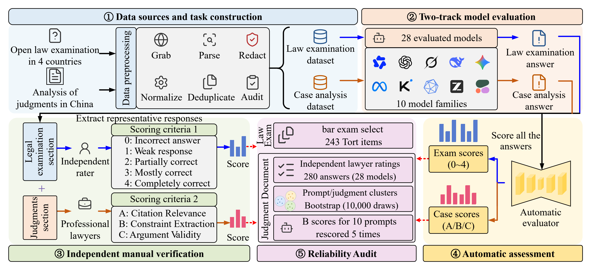

# LegalScope

Code and data for [**LegalScope: Measuring Exam-to-Case Transfer in LLM Legal Reasoning**](https://openreview.net/forum?id=BNx62Wx1ej).

**AI Measurement Science (AIMS) Workshop at COLM 2026**

[Project page](https://eternwang.github.io/LegalScope/) ·
[Paper](https://openreview.net/forum?id=BNx62Wx1ej) ·
[Dataset](https://huggingface.co/datasets/Hongyu801/LegalScope) ·
[Examples](https://eternwang.github.io/LegalScope/examples.html) ·
[Results](https://eternwang.github.io/LegalScope/results.html)

LegalScope studies whether strong legal-exam performance carries over to reasoning
about real cases. We evaluate the same **28 model configurations** on **861 exam
questions** from the United States, China, the United Kingdom and Australia, and
**276 case prompts** from 56 de-identified Chinese judgments. The case track pairs
supporting and opposing stances for each of 138 legal issues.

<a href="assets/figures/paper_collection_pipeline.png"></a>

## Key findings

- Automatic exam and case scores correlate across models (Pearson **0.817**, Spearman **0.708**),
  but rankings and gains from model variants differ between tracks.
- Mean automatic scores are lower for citation relevance than argument validity:
  **66.9 vs. 72.6** on a 0–100 scale.
- Automatic–human agreement is stronger for exam answers than case answers:
  Pearson **0.910 vs. 0.312**.

See the [full results](https://eternwang.github.io/LegalScope/results.html) for
model scores, plots and explanations.

## Data

| Material | Records | Download |
| --- | ---: | --- |
| Case prompts and separate scoring references | 276 each | [Case data](https://huggingface.co/datasets/Hongyu801/LegalScope/tree/main/data/cases) |
| Victorian Bar source excerpts and selected candidate answers | 78 | [Exam sources](https://huggingface.co/datasets/Hongyu801/LegalScope/tree/main/data/victorian_bar) |
| Case model responses, translated into English | 7,728 | [Responses](https://huggingface.co/datasets/Hongyu801/LegalScope/tree/main/data/results) |
| Individual automatic and human scores | 34,636 | [Scores](data/results/answer_scores.csv.gz) |
| Aggregate performance and model roster | 28 each | [Metadata](data/metadata) |

All case prompts are available. The exam release contains publisher excerpts
for the Victorian Bar subset; the full 861 evaluation prompts are not released.
The [loading guide](docs/USING_THE_RELEASE.md) covers dataset loading, field names
and version pinning.

## Project structure

```text
LegalScope/
├── data/          # Example tasks, individual scores and benchmark metadata
├── evaluation/    # Response generation, scoring and rubrics
├── src/legalscope/ # Result aggregation and reference comparison utilities
├── docs/          # Data, methods and reproducibility guides
├── assets/figures/ # Paper figures
├── site/          # Project website
└── scripts/       # Site build and data utilities
```

## Quick start

### 1. Install

Python 3.10 or later is required.

```sh
git clone https://github.com/EternWang/LegalScope.git
cd LegalScope
python -m pip install -e .
```

### 2. Reproduce the published results

```sh
python -m legalscope.results \
  --scores data/results/answer_scores.csv.gz \
  --roster data/metadata/model_groups.csv \
  --published data/metadata/model_performance.csv
```

This recomputes all 252 values in workshop Table 3 from the released individual
scores. See [reproducibility](docs/REPRODUCIBILITY.md) for score fields and aggregation.

### 3. Evaluate model answers

Follow the [evaluation guide](evaluation/README.md) to load case prompts,
generate answers, translate them and run the scorer.

- **Exam answers:** scored from 0 to 4 against the reference answer's issue,
  rule, application and conclusion.
- **Case answers:** English prompt → Chinese answer → GPT-5.5 English translation
  → three 0–4 scores for citation relevance, constraint extraction and argument validity.
  Scoring references are provided only to the evaluator.
- **Reported results:** model averages on a 0–100 scale; the case mean averages
  the three dimensions.
- **Human validation:** 80 exam questions and 10 case prompts across all 28
  configurations. Two lawyers independently rate the same 280 case answers.

Details: [scoring protocol](docs/SCORING_RUBRIC.md) ·
[human annotation](docs/ANNOTATION_PROTOCOL.md) ·
[model settings](docs/MODEL_SETTINGS.md) ·
[data card](docs/DATA_CARD.md)

## Citation

```bibtex
@inproceedings{wang2026legalscope,
  title = {{LegalScope}: Measuring Exam-to-Case Transfer in {LLM} Legal Reasoning},
  author = {Wang, Hongyu and Han, Rilyn R. and Zhao, Yilun and Zhao, Xuandong and Cohan, Arman},
  booktitle = {AI Measurement Science Workshop at COLM 2026},
  year = {2026},
  url = {https://openreview.net/forum?id=BNx62Wx1ej}
}
```

## Licenses

Project-authored code, documentation, metadata and case annotations use
[MIT](LICENSE). Victorian Bar excerpts retain **CC BY-NC-ND 4.0**, with their
attribution and notices; see [third-party notices](THIRD_PARTY_NOTICES.txt).
Original judgments are not included in the release.
